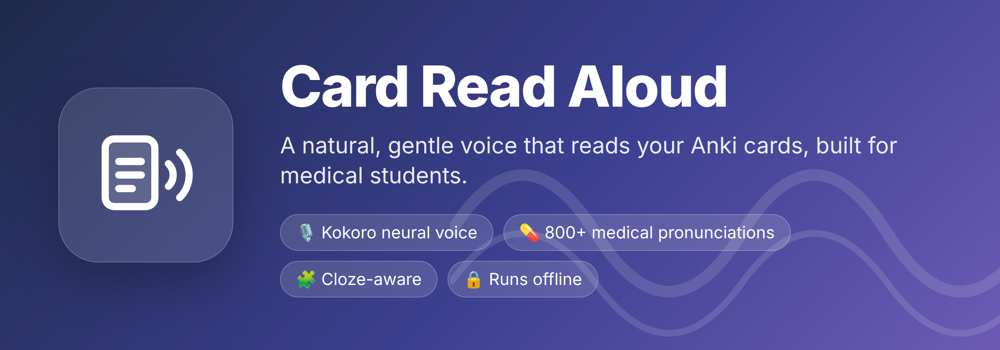
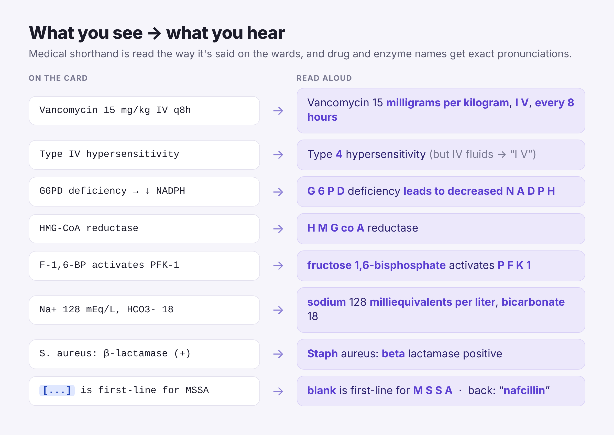
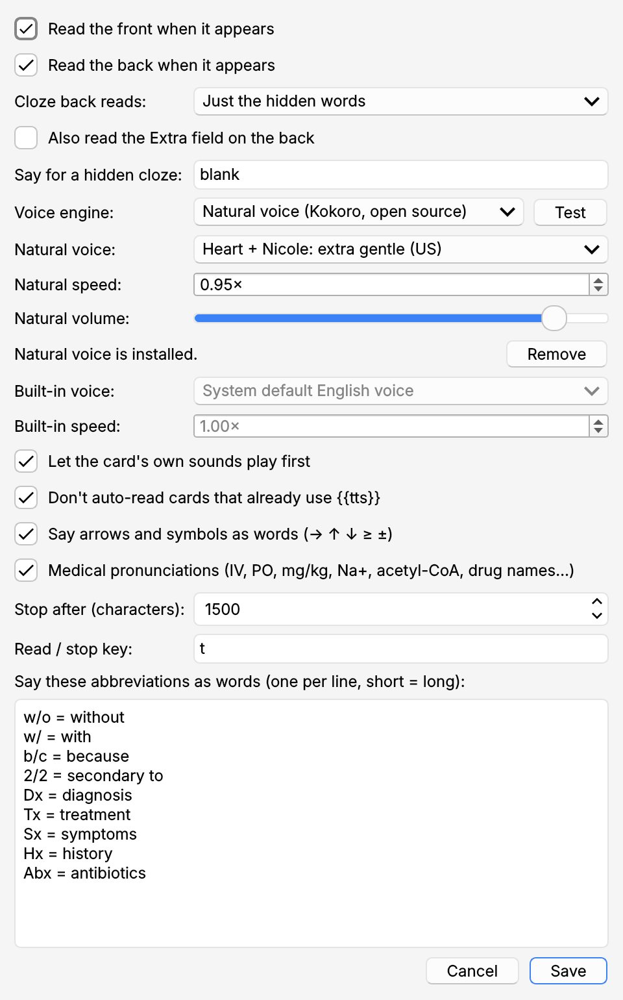

**Card Read Aloud** reads your review cards out loud in a natural, gentle human-sounding voice. It's built for medical students using AnKing and other med decks, so it says **"I V"**, not *"Roman four"*.

---

## 🎙️ A real neural voice, free and open source

The natural voice is **[Kokoro](https://huggingface.co/hexgrad/Kokoro-82M)**, a free, open-source neural text-to-speech model (Apache 2.0). It runs **on your own computer and works offline**. Your cards never leave your machine.

- 🗣️ Gentle voices to choose from: **Heart** (warm), **Nicole** (soft, almost a whisper), a **Heart + Nicole** blend, Bella, Emma, Michael and more
- ⚡ **Speaks live, with no pre-rendering.** There's no waiting to generate audio and no sound files added to your collection, so syncing stays fast
- 🎚️ Adjustable speed and volume

> ⚠️ **Heads-up: one-time ~500 MB download.** The natural voice isn't bundled. When you turn it on (**Tools → Card Read Aloud → Settings → Download**), the add-on downloads the voice model and a small private Python engine, about 500 MB. This happens once. It lives inside the add-on's own folder, never touches Anki's Python, and the **Remove** button deletes all of it.
>
> Don't want the download? Choose **Built-in voice** to use your computer's own voices instead.

---

## 💊 Medical pronunciation built in

- **Shorthand is read the way it's said on the wards.** IV, PO, BID and PRN are spelled out; *q8h* becomes "every 8 hours"; *15 mg/kg* becomes "15 milligrams per kilogram"
- **Roman numerals that are numbers stay numbers.** *Type IV*, *factor VIII* and *CN VII* are read as 4, 8 and 7
- **Ions and labs:** Na⁺, K⁺ and HCO₃⁻ become sodium, potassium and bicarbonate; *mEq/L*, *mmHg* and *cells/mm³* are read in full
- **Biochemistry:** acetyl-CoA, HMG-CoA, NADPH, G6PD, F-1,6-BP, G3P, 2,3-BPG, α-KG, CoQ10, CD4⁺, IL-6, TNF-α and β-lactam all come out right
- **800+ exact pronunciations** (natural voice) for drug, bug and biochemistry names the voice would otherwise mispronounce: antibiotics, antivirals, cardiac and psych drugs, -mabs, the urea cycle, amino acids, lipid metabolism and the lysosomal storage diseases
- Add your own words in Settings

---

## 🧩 Reads the card the way you study it

- **Front** is read when the card appears and the **back** when you flip. Press **T** to replay the current side or stop
- **Cloze-aware:** the front says "blank" for the hidden part (plus the hint, if any); the back reads just the answer, or the whole sentence if you prefer
- **Skips the clutter:** images, sound buttons, collapsed hint fields (Lecture Notes, Missed Questions…), the AnKing countdown timer and the tag bar
- **Plays nicely with your card audio:** it waits for the card's own sounds to finish and stops when you flip or answer

---

## ⚙️ Settings

Open **Tools → Card Read Aloud → Settings**, or the **Config** button in the Add-ons window.

---

## ℹ️ Good to know

- Tested on **Anki 26.9** on macOS (Apple Silicon). Windows and Linux should work too; please report any problems on the support page
- The natural voice downloads its pieces from PyPI (uv, kokoro-onnx, onnxruntime) and from the kokoro-onnx release on GitHub, with Hugging Face as a backup
- Works alongside theme and answer-sound add-ons

---

Voice: [Kokoro-82M](https://huggingface.co/hexgrad/Kokoro-82M) by hexgrad (Apache 2.0), run with [kokoro-onnx](https://github.com/thewh1teagle/kokoro-onnx). Add-on built with [Claude](https://claude.ai) by Anthropic.

---

## Install

- **From AnkiWeb:** Tools → Add-ons → Get Add-ons, then paste the add-on's code.
- **From this repo:** download `card_read_aloud.ankiaddon` from the Releases page and double-click it, or copy the `card_read_aloud` folder into Anki's `addons21` folder.

## Report a problem

Open an [issue](https://github.com/aidansun525/Anki-Card-read-aloud/issues). Include your Anki version, your operating system and, for natural voice problems, the file `card_read_aloud/user_files/natural_voice/log.txt`.
